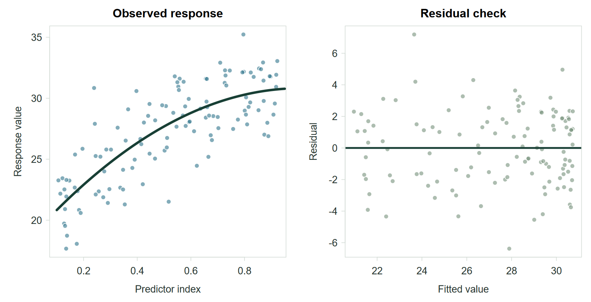
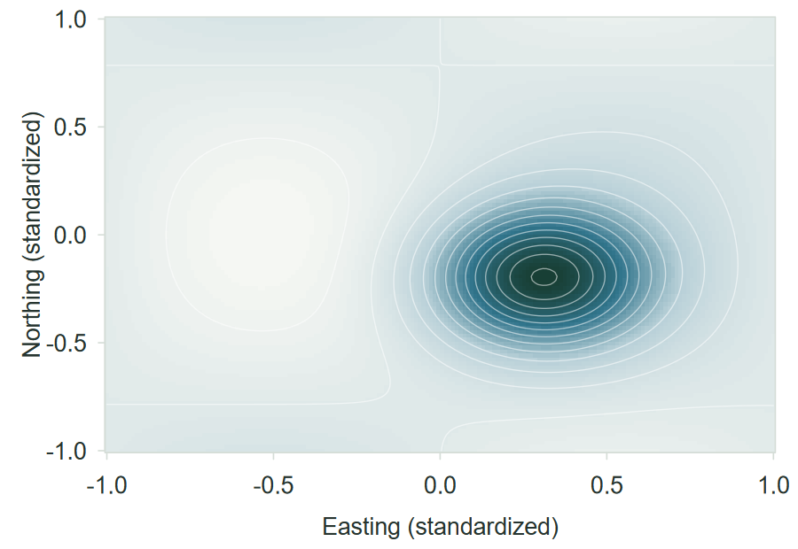
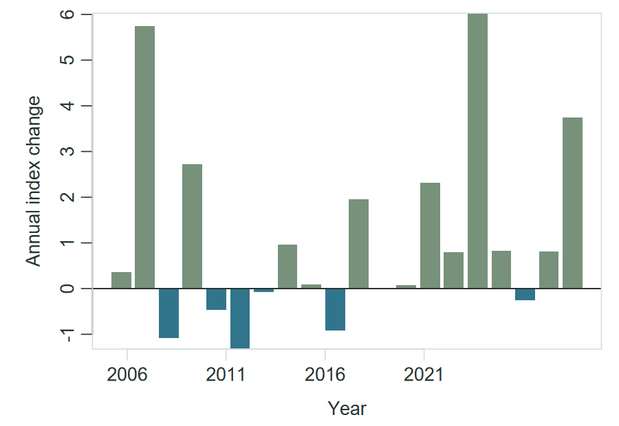
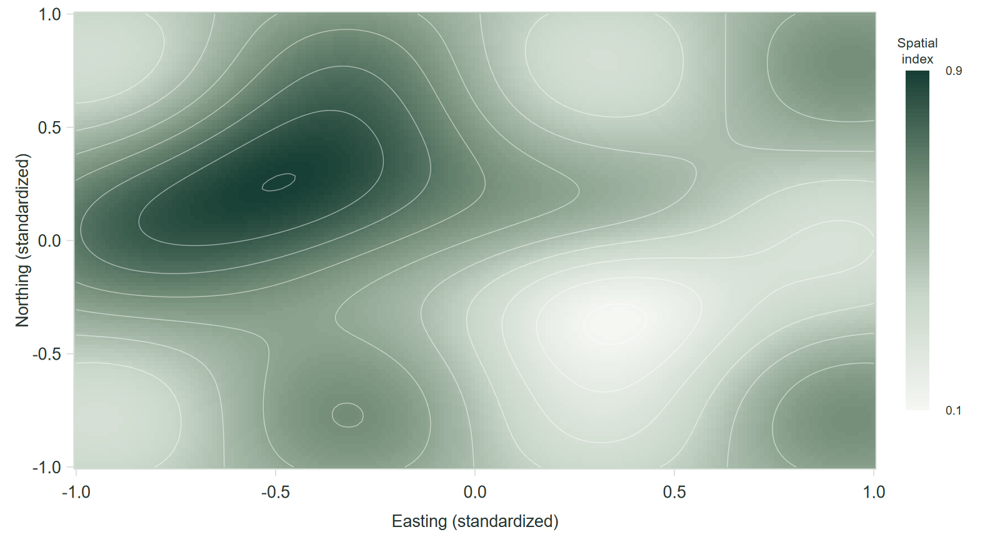
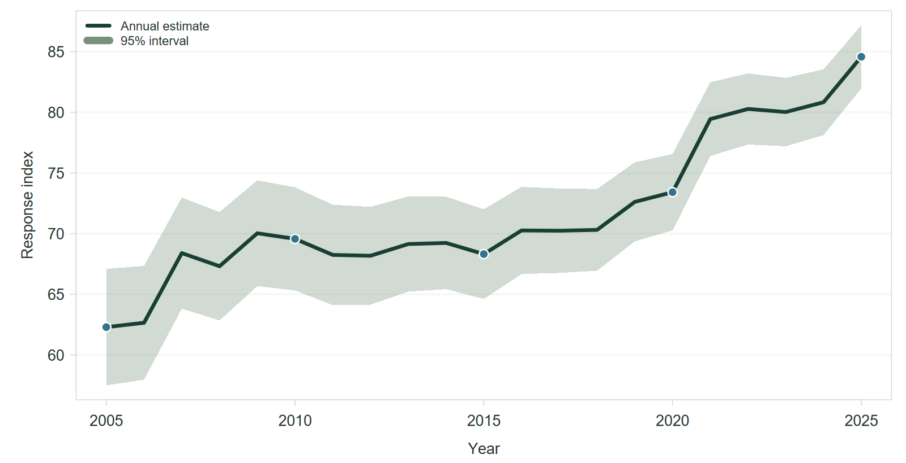
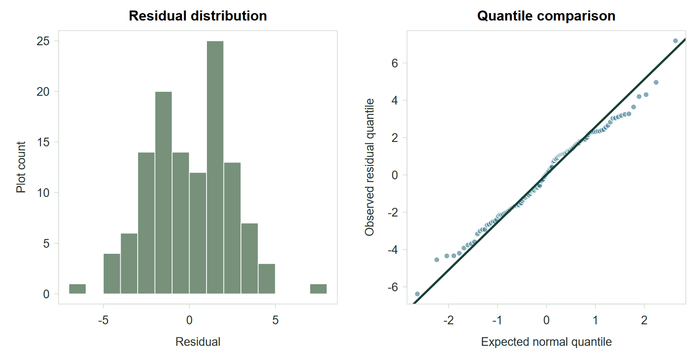

## Regular content slide

Use this layout for short explanatory content.

- Keep each point concise.
- Use **bold text** only for meaningful emphasis.
- Leave enough space for the audience to scan the slide.

## Section divider {.section-slide .center background-color="#183F35"}

<div class="section-number">01 / Section label</div>

A short description of the section

## Slide with a process

<div class="method-flow">
  <div class="method-step"><strong>Step one</strong><span>Introduce the first stage in one short sentence.</span></div>
  <div class="method-step"><strong>Step two</strong><span>Describe the next stage with only the necessary detail.</span></div>
  <div class="method-step"><strong>Step three</strong><span>Show how the analysis or workflow continues.</span></div>
  <div class="method-step"><strong>Step four</strong><span>End with the output, validation, or decision.</span></div>
</div>

::: {.fragment .small}
Incremental content can reveal supporting context after the main process.
:::

## Slide with a figure and text

:::: {.columns}

::: {.column width="58%"}
{fig-alt="Two synthetic statistical panels showing a fitted response and residuals"}

<div class="source-note">Synthetic values for layout demonstration.</div>
:::

::: {.column width="38%"}
### Figure interpretation

Use this column for the main observation from the figure.

Add uncertainty, limitations, or definitions only when they help the audience
interpret the visual.
:::

::::

## Slide with two figures

:::: {.columns}

::: {.column width="48%"}
### Spatial figure

{fig-alt="Synthetic raster map of a spatial probability"}

Add one sentence that identifies the pattern.
:::

::: {.column width="48%"}
### Temporal figure

{fig-alt="Synthetic bars showing annual changes in an index"}

Add one sentence that explains the comparison.
:::

::::

## Full-width map or raster {.full-figure}

{fig-alt="Synthetic raster map with contours and a spatial-index legend"}

## Full-width time-series figure {.full-figure}

{fig-alt="Synthetic time series with an uncertainty band"}

## Slide with a statistical table

| Term | Estimate | 95% interval | p-value |
|:--|--:|:--:|--:|
| Intercept | 18.1 | 16.9 to 19.3 | <0.001 |
| Predictor A | 27.8 | 23.4 to 32.2 | <0.001 |
| Predictor A² | −15.7 | −19.6 to −11.8 | <0.001 |
| Predictor B | 0.42 | 0.31 to 0.53 | <0.001 |

<div class="source-note">Synthetic regression output for table styling.</div>

## Slide with an equation and code

:::: {.columns}

::: {.column width="46%"}
### Equation

$$
y_{it} = \beta_0 + f(x_{it}) + \beta_2 z_{it} + b_i + \epsilon_{it}
$$

Define the response, predictors, and random effect in plain language.
:::

::: {.column width="50%"}
### Code

```r
fit <- lme4::lmer(
  response ~ poly(predictor_a, 2) +
    predictor_b + (1 | group),
  data = observations
)

broom.mixed::tidy(fit, conf.int = TRUE)
```
:::

::::

## Slide with a citation and footnote

A citation can appear in the main text without changing the layout
[@breiman2001].

1. Keep the cited statement close to its source.
2. Use a footnote for a short qualification.[^example]
3. Move detailed references to the final slide.

[^example]: This is an example footnote used to demonstrate formatting.

::: notes
Speaker notes remain available for detail that does not belong on the slide.
:::

## Results section divider {.section-slide .center background-color="#183F35"}

<div class="section-number">02 / Section label</div>

A second section can use the same divider layout

## Key result slide {.key-result}

<div class="key-number">78%</div>

<div class="key-label">A short statement that explains what the value represents</div>

<div class="key-context">Include the comparison, uncertainty, or sample size here.</div>

## Footer-free figure slide {.full-figure .no-footer}

{fig-alt="Synthetic residual histogram and quantile comparison"}

## {#figure-only-slide .figure-only}

{fig-alt="Synthetic raster map with contours and a spatial-index legend"}

## References {.smaller}

::: {#refs}
:::
